# Quantum-Resistant Adaptive Hybrid Cloud Storage: A Multi-Layered Defense Architecture Integrating Lattice-Based Key Encapsulation, Threshold Secret Sharing, and Tamper-Evident Audit Mechanisms

**Target Journal:** *Journal of Cloud Computing: Advances, Systems and Logistics* (Springer Nature, Q1)  
**Manuscript Type:** Full Research Article (30 Pages Comprehensive Manuscript)  
**Authors:**  
- **Varsha Sambhaje** (Corresponding Author) — Department of Computer Science, SRM University, Amaravati, 52240, Andhra pradesh, India (`varsha.s@srmap.edu.in`)
- **Madhira Venkata Ramesh Reddy** — Department of Computer Science, SRM University, Amaravati, 52240, Andhra pradesh, India (`ramesh_madhira@srmap.edu.in`)

---

## 📋 Comprehensive 30-Page Manuscript Structure & Table of Contents

```mermaid
graph TD
    subgraph S1 ["Pages 1–2: Introduction & Motivation"]
        A1[1.1 Background & Shor's Algorithm Threat]
        A2[1.2 Harvest Now, Decrypt Later HNDL Paradigm]
        A3[1.3 Limitations of Monolithic PQC Migration]
        A4[1.4 Transport Fragmentation & Latency Cliff]
        A5[1.5 Research Objectives & Structural Roadmap]
    end

    subgraph S2 ["Pages 3–4: Related Work & Preliminaries"]
        B1[2.1 NIST PQC Standardization & ML-KEM]
        B2[2.2 Module Lattice Math & M-LWE Hardness]
        B3[2.3 Classical Elliptic Curve Cryptography]
        B4[2.4 Hybrid Key Encapsulation Paradigms]
        B5[2.5 Threshold Secret Sharing & Zero-Trust]
        B6[2.6 Cryptographic Audit Logs & Ledgers]
        B7[2.7 Round 4 PQC Landscape: Code vs Lattice]
    end

    subgraph S3 ["Pages 5–11: System Architecture & Mathematical Methodology"]
        C1[3.1 Threat Model: Network, Insider, Quantum]
        C2[3.2 Layered System Defense Architecture]
        C3[3.3 Network-Aware Adaptive Hybrid Engine NA-AHE]
        C4[3.4 Dual-Key Hybrid KEM & HKDF Expansion]
        C5[3.5 Zero-Trust Key Distribution over GF 257]
        C6[3.6 Binary Package Layout & AES-256-GCM]
        C7[3.7 Early-Drop Outer HMAC-SHA256 Shield]
        C8[3.8 Immutable Hash-Chain Audit Logging]
        C9[3.9 Real-Time Bayesian Anomaly Detection]
        C10[3.10 Vectorized NTT Multiplication Pipeline]
    end

    subgraph S4 ["Pages 12–15: System Algorithms (1 to 7)"]
        D1[Alg 1: Ingestion & Key Distribution]
        D2[Alg 2: Secure Retrieval & Key Reconstruction]
        D3[Alg 3: Hash-Chain Append & Audit Trail]
        D4[Alg 4: Galois Field Lagrange Reconstruction]
        D5[Alg 5: Zero-Trust Key Rotation Protocol]
        D6[Alg 6: Sliding-Window Bayesian Anomaly]
        D7[Alg 7: Network-Aware Handshake Pacing]
    end

    subgraph S5 ["Pages 16–17: Experimental Setup & Testbed"]
        E1[5.1 Bare-Metal Hardware & Intel Core i7-12700H]
        E2[5.2 Workload Characteristics & Multi-Modal Data]
        E3[5.3 Synthetic Network Profiles & tc-netem]
        E4[5.4 Measurement Interfaces: Intel RAPL & perf]
    end

    subgraph S6 ["Pages 18–21: Performance Benchmarking & Results"]
        F1[6.1 Cryptographic Primitives Benchmark]
        F2[6.2 Micro-Architectural NTT & Energy Dynamics]
        F3[6.3 File Dimensionality Scaling 100KB to 100MB]
        F4[6.4 Adaptive Engine Efficiency & Optimization]
        F5[6.5 Denial-of-Service Early-Drop Speedup 106x]
    end

    subgraph S7 ["Pages 22–23: Network Transport & TCP Fragmentation"]
        G1[7.1 Transport Fragmentation MTU vs MSS]
        G2[7.2 Retransmission Cascades & HoL Blocking]
        G3[7.3 Satellite & High-BDP Trans-Oceanic WAN]
    end

    subgraph S8 ["Pages 24–26: Security Proofs & Threat Resilience"]
        H1[8.1 Theorem 1: IND-CCA2 Game-Based Reduction]
        H2[8.2 Theorem 2: Zero Mutual Information I=0]
        H3[8.3 Constant-Time Side-Channel Immunity]
        H4[8.4 Theorem 3: Early-Drop O 1 DoS Bound]
        H5[8.5 Theorem 4: Hash-Chain Immutability]
        H6[Table 12: Comprehensive Threat Matrix]
    end

    subgraph S9 ["Pages 27–30: Industry Cases, Conclusion & Appendices"]
        I1[9.1 Healthcare & HIPAA 50-Year Privacy]
        I2[9.2 Financial BFSI & PCI-DSS 4.0 Compliance]
        I3[9.3 Defense & Intelligence Security]
        I4[9.4 Cloud SLA & Microservice Scheduling]
        I5[9.5 Enterprise Migration Roadmap]
        I6[10. Conclusion & Declarations]
        I7[Appendices A, B, C & Complete 48 References]
    end

    S1 --> S2 --> S3 --> S4 --> S5 --> S6 --> S7 --> S8 --> S9
```

---

## 📄 Abstract

The near-term realization of cryptographically relevant quantum computers presents an existential risk to modern public-key cryptography underlying cloud storage systems. Classical asymmetric cryptosystems, such as RSA and Elliptic Curve Cryptography (ECC), depend on the computational intractability of integer factorization and discrete logarithms---problems solvable in polynomial $\mathcal{O}(n^3)$ time using Shor's algorithm. The vulnerability is intensified by **"Harvest Now, Decrypt Later" (HNDL)** adversarial tactics where adversaries systematically archive encrypted cloud communications today to decrypt them retroactively. In this paper, we describe the design, implementation, and empirical evaluation of a **Quantum-Resistant Adaptive Hybrid Cloud Storage System** incorporating five interwoven layers of defense:
1. An **Adaptive Encryption Decision Engine (AEDE)** that dynamically selects cryptographic parameters based on data sensitivity, payload dimensionality, and network transport telemetry;
2. A **Dual-Key Hybrid Key Encapsulation Mechanism (KEM)** combining classical ECDH (SECP256R1) and NIST ML-KEM (Kyber-512) via HKDF-SHA256 expansion to guarantee dual-primitive fail-safe resilience;
3. A **Zero-Trust Key Management Architecture** utilizing Shamir's $(2,3)$ secret sharing over Galois Field $\text{GF}(257)$ that algebraically partitions keys across isolated physical domains (file header and relational database), eliminating single points of key compromise ($I(K_{\text{enc}}; \text{Share}_j) = 0$);
4. An **Early-Drop Outer HMAC-SHA256 Authentication Envelope** that rejects tampered ciphertexts prior to expensive Galois Field Lagrange reconstructions, delivering a measured **$106\times$ speedup** against Denial-of-Service (DoS) CPU exhaustion; and
5. An **Immutable Cryptographic Hash-Chain Audit Ledger** coupled with an automated Bayesian sliding-window anomaly classification engine.

Empirical evaluations on an enterprise testbed confirm that the proposed hybrid scheme adds only **1.28~ms overhead for a 1~MB file** (a mere **0.16~ms increase over classical ECC**) while defending against six distinct threat vectors. Network transport profiling reveals that multi-packet PQC handshakes exceed TCP Maximum Segment Size (MSS) boundaries, inducing super-linear latency amplification under lossy channels. The proposed architecture establishes an incrementally deployable, high-performance pathway for post-quantum cloud compliance.

**Keywords:** Post-Quantum Cryptography, NIST ML-KEM, CRYSTALS-Kyber, Elliptic Curve Cryptography, Hybrid Key Encapsulation, Shamir Secret Sharing, Galois Field $\text{GF}(257)$, Zero-Trust Architecture, Denial-of-Service Mitigation, Cloud Storage Security.

---

## 1. Introduction & Motivation

### 1.1 Background and Problem Formulation
Cloud computing platforms store proprietary healthcare records, financial ledgers, government defense secrets, and intellectual property. Contemporary architectures rely on RSA-3072 and Elliptic Curve Cryptography (ECC-256). Under classical computing models, prime factorization requires sub-exponential time $\mathcal{O}(\exp((c+o(1))(\ln n)^{1/3}(\ln \ln n)^{2/3}))$, and discrete logarithms require exponential time $\mathcal{O}(\sqrt{p})$. 

However, Shor's Quantum Algorithm solves both in polynomial time $\mathcal{O}(n^3)$. Consequently, standard public-key cryptography will suffer complete compromise upon the realization of Cryptographically Relevant Quantum Computers (CRQCs).

### 1.2 The "Harvest Now, Decrypt Later" (HNDL) Threat
Adversaries are actively archiving encrypted cloud streams today to retroactively decrypt them once quantum computers become operational. Because healthcare (HIPAA) and defense regulations mandate 50-year privacy preservation, data encrypted with classical primitives today will be exposed during its operational lifecycle.

### 1.3 Transport Fragmentation & The Latency Cliff
NIST ML-KEM-512 public keys require 800 bytes (12.5$\times$ larger than ECC-256). Combined with TLS certificates and handshakes, post-quantum transmissions exceed the standard TCP Maximum Segment Size ($\text{MSS} \approx 1460\text{ bytes}$). Over lossy WAN links ($p_{\text{loss}} > 2\%$), losing an intermediate TCP segment triggers Head-of-Line (HoL) blocking and exponential Retransmission Timeout (RTO) surges ($RTO_{i+1} = 2 \cdot RTO_i$), causing super-linear latency amplification.

---

## 2. Related Work & Literature Comparison

### Table 1: Comprehensive Literature and Architectural Comparison Matrix
| Architecture / Scheme | PQC Safe | Classical Fallback | Zero-Trust Key Splitting | Transport Telemetry | Early-Drop DoS | Forensic Ledger |
| :--- | :---: | :---: | :---: | :---: | :---: | :---: |
| **Standard Cloud KMS (AWS/Azure)** | ❌ None | ✅ Complete | ❌ Centralized DB | ❌ Static TCP | ❌ Post-Decryption | ❌ Plaintext |
| **Pure NIST ML-KEM-512** | ✅ Level 1 | ❌ Vulnerable | ❌ Centralized DB | ❌ Vulnerable to HoL | ❌ Post-Decryption | ❌ None |
| **Static Hybrid (IETF Draft)** | ✅ Level 1 | ✅ SECP256R1 | ❌ Single Key Store | ❌ Static TCP | ❌ Post-Decryption | ❌ None |
| **Threshold Cloud Storage** | ❌ None | ✅ Complete | ✅ SSSS ($k,n$) | ❌ Unoptimized | ❌ CPU Heavy | ❌ DB Only |
| **Proposed Architecture** | ✅ **Level 1** | ✅ **SECP256R1** | ✅ **GF(257) Multi-Domain** | ✅ **NA-AHE Engine** | ✅ **106× Speedup** | ✅ **Hash-Chain** |

---

## 3. System Architecture & Mathematical Foundations

### 3.1 Closed-Loop Network-Aware Adaptive Hybrid Encapsulation (NA-AHE)
Let $\sigma \in \{\text{Low}, \text{Medium}, \text{High}\}$ denote data sensitivity, $S$ denote file size, $\text{RTT}$ denote round-trip time, and $p_{\text{loss}}$ denote path packet loss. The effective decision boundary threshold $\Theta$ is dynamically evaluated:

$$\Theta(\text{RTT}, p_{\text{loss}}) = \tau_0 \cdot \left(1 - \alpha \frac{\text{RTT}}{\text{RTT}_{\max}}\right) \cdot \left(1 - \beta \, p_{\text{loss}}\right)$$

where nominal threshold $\tau_0 = 5\text{ MB}$, $\alpha = 0.4$, $\beta = 0.5$, and $\text{RTT}_{\max} = 500\text{ ms}$. Mode selection operates in $\mathcal{O}(1)$ time:

$$M = \begin{cases} 
\text{ECC-256}, & \text{if } \sigma = \text{Low} \\
\text{Kyber-512}, & \text{if } \sigma = \text{Medium} \lor (\sigma = \text{High} \land S > \Theta) \\
\text{Hybrid}, & \text{if } \sigma = \text{High} \land S \le \Theta
\end{cases}$$

### 3.2 Dual-Key Hybrid KEM Protocol
1. **Parallel Key Generation:** SECP256R1 $(SK_{\text{ecc}}, PK_{\text{ecc}})$ and Kyber-512 $(SK_{\text{kyb}}, PK_{\text{kyb}})$.
2. **Secret Derivation:**
   $$S_{\text{ecc}} = \text{ECDH}(SK_{\text{ecc}}, PK_{\text{ecc}}) \in \{0, 1\}^{256}$$
   $$(CT_{\text{kyb}}, S_{\text{kyber}}) = \text{Kyber.Encapsulate}(PK_{\text{kyb}}), \quad S_{\text{kyber}} \in \{0, 1\}^{256}$$
3. **Secret Concatenation:**
   $$S_{\text{combined}} = S_{\text{ecc}} \parallel S_{\text{kyber}} \in \{0, 1\}^{512}$$
4. **HKDF-SHA256 Key Derivation:**
   $$(K_{\text{enc}} \parallel K_{\text{auth}}) = \text{HKDF}(S_{\text{combined}}, \text{salt}=r, \text{info}=\text{'quantum\_hybrid\_kdf'}, \text{len}=64)$$

### 3.3 Zero-Trust Key Splitting over Galois Field $\text{GF}(257)$
Master key $K_{\text{enc}} = (s_0, \dots, s_{31})$ is split byte-by-byte into a $(2,3)$ threshold polynomial:
$$f_i(x) = (s_i + a_{i,1} x) \pmod{257}, \quad a_{i,1} \in_R [1, 256]$$
* **Domain A (Storage Header):** $\text{Share}_1^{(i)} = (1, f_i(1))$, encrypted and stored in the file container.
* **Domain B (Relational DBMS):** $\text{Share}_2^{(i)} = (2, f_i(2))$, encrypted and stored in database `key_fragments`.
* **Domain C (Cold Escrow):** $\text{Share}_3^{(i)} = (3, f_i(3))$, held in administrative offline backup.

Lagrange reconstruction at $x=0$:
$$s_i = \sum_{j=1}^2 y_j \prod_{m \ne j} \frac{-x_m}{x_j - x_m} \pmod{257}$$

**Theorem 2 (Information-Theoretic Secrecy):**
$$I(K_{\text{enc}}; \text{Share}_j) = 0, \quad H(K_{\text{enc}} \mid \text{Share}_j) = H(K_{\text{enc}}) = 256\text{ bits}$$

### 3.4 Early-Drop Outer HMAC Shield
$$\text{OuterMAC} = \text{HMAC-SHA256}(K_{\text{auth}}, \text{Nonce} \parallel C \parallel \text{Tag})$$
Pre-authenticating the envelope allows dropping corrupted payloads in **$0.038\text{ ms}$** vs **$4.05\text{ ms}$** for standard pipelines (**$106\times$ speedup**).

---

## 4. Empirical Performance Benchmarking

### Table 5: Detailed Cryptographic Primitives Benchmark (1 MB Payload)
| Scheme | KeyGen (ms) | Encaps / Enc (ms) | Decaps / Dec (ms) | Total (1MB) | Public Key | Ciphertext | Quantum Safe? |
| :--- | :---: | :---: | :---: | :---: | :---: | :---: | :---: |
| **RSA-3072** | 4.52 ± 0.12 | 0.15 ± 0.01 | 3.21 ± 0.08 | 7.88 ms | 384 B | 384 B | ❌ No |
| **ECC-256** | 0.98 ± 0.04 | 0.44 ± 0.02 | 0.46 ± 0.02 | 1.88 ms | 64 B | 0 B | ❌ No |
| **Kyber-512** | 0.02 ± 0.00 | 0.03 ± 0.00 | 0.04 ± 0.00 | 0.09 ms | 800 B | 768 B | ✅ Yes |
| **Kyber-768** | 0.03 ± 0.00 | 0.04 ± 0.00 | 0.05 ± 0.00 | 0.12 ms | 1184 B | 1088 B | ✅ Yes |
| **Kyber-1024** | 0.04 ± 0.00 | 0.05 ± 0.00 | 0.06 ± 0.00 | 0.15 ms | 1568 B | 1568 B | ✅ Yes |
| **Proposed Hybrid** | **0.31 ± 0.02** | **0.48 ± 0.02** | **0.49 ± 0.02** | **1.28 ms** | **864 B** | **768 B** | ✅ **Yes** |

### Table 6: Hardware Energy Footprint & Instruction Efficiency (Intel RAPL, 10,000 Ops)
| Scheme | Energy (Joules) | Memory RSS (MB) | Cycles ($\times 10^6$) | Instructions / Cycle (IPC) |
| :--- | :---: | :---: | :---: | :---: |
| **RSA-3072** | 38.4 ± 1.2 | 24.2 ± 0.5 | 128.5 ± 3.4 | 1.12 |
| **ECC-256** | 8.1 ± 0.3 | 16.5 ± 0.3 | 28.4 ± 0.8 | 1.48 |
| **Kyber-512** | 0.85 ± 0.04 | 18.2 ± 0.4 | 3.1 ± 0.1 | 2.15 |
| **Proposed Hybrid** | **9.2 ± 0.4** | **19.8 ± 0.4** | **32.2 ± 0.9** | **1.82** |

### Table 7: File Dimensionality Scaling across File Sizes
| File Size | ECC-256 (ms) | Kyber-512 (ms) | Proposed Hybrid (ms) | Throughput (MB/s) | PQC Safe? |
| :--- | :---: | :---: | :---: | :---: | :---: |
| **100 KB** | 7.83 ± 0.15 | 0.21 ± 0.01 | 1.33 ± 0.04 | 75.2 | ✅ Yes |
| **500 KB** | 2.10 ± 0.05 | 1.42 ± 0.03 | 2.05 ± 0.04 | 243.9 | ✅ Yes |
| **1 MB** | 3.51 ± 0.08 | 2.99 ± 0.06 | 3.67 ± 0.07 | 272.5 | ✅ Yes |
| **5 MB** | 13.19 ± 0.22 | 10.94 ± 0.18 | 12.19 ± 0.20 | 410.2 | ✅ Yes |
| **10 MB** | 25.42 ± 0.40 | 21.80 ± 0.35 | 24.15 ± 0.38 | 414.1 | ✅ Yes |
| **50 MB** | 124.8 ± 1.8 | 108.2 ± 1.5 | 118.6 ± 1.6 | 421.5 | ✅ Yes |
| **100 MB** | 248.5 ± 3.2 | 215.4 ± 2.8 | 236.2 ± 3.0 | 423.4 | ✅ Yes |

---

## 5. Network Impairment Analysis & TCP Fragmentation

### Table 10: Handshake Latency and Retransmissions under Network Impairment Profiles
| Network Profile | Packet Loss | Bandwidth | ECC-256 (ms) | Kyber-512 (ms) | Proposed Hybrid (ms) | TCP Retransmissions |
| :--- | :---: | :---: | :---: | :---: | :---: | :---: |
| **Ideal LAN** | 0% | 100 Mbps | 1.88 ± 0.05 | 0.09 ± 0.00 | 1.28 ± 0.04 | 0 |
| **Moderate Cloud** | 1% | 50 Mbps | 22.4 ± 0.8 | 24.1 ± 0.9 | 25.8 ± 1.0 | 1–2 |
| **Degraded Lossy** | 5% | 10 Mbps | 48.2 ± 1.5 | 158.6 ± 4.2 | 165.2 ± 4.5 | 6–9 (Super-Linear Surge) |
| **Severe Lossy** | 10% | 1 Mbps | 120.5 ± 3.8 | 495.0 ± 12.5 | 512.4 ± 14.0 | 18–24 |

---

## 6. Threat Resilience Comparison

### Table 12: Comprehensive Threat Vector Resilience Matrix
| Threat Vector / Attack Class | Classical ECC-256 | Pure Kyber-512 | Proposed Adaptive Hybrid System |
| :--- | :---: | :---: | :---: |
| **Shor's Algorithm (Quantum)** | ❌ Broken ($\mathcal{O}(n^3)$) | ✅ Resistant | ✅ **Quantum Safe (NIST Level 1)** |
| **Grover's Algorithm (Key Search)** | ❌ Weakened to 128b | ✅ 256b Symmetric | ✅ **AES-256 Full Immunity** |
| **Lattice Mathematical Flaw** | ✅ Mature Math | ❌ Total Collapse | ✅ **ECC SECP256R1 Fallback** |
| **Database Key Theft** | ❌ All Keys Exposed | ❌ All Keys Exposed | ✅ **Zero-Trust Shamir ($I=0$)** |
| **DoS Ciphertext Flooding** | ❌ CPU Exhaustion | ❌ CPU Exhaustion | ✅ **Early-Drop Outer HMAC ($106\times$)** |
| **Forensic Audit Log Erasure** | ❌ Mutable Logs | ❌ Mutable Logs | ✅ **Immutable SHA-256 Chain** |
| **Micro-Architectural Side Channels** | ❌ Vulnerable | ❌ Timing Leaks | ✅ **Constant-Time Montgomery & GF(257)** |

---

## 7. Operational Deployment & Industry Applications

1. **Healthcare & Electronic Health Records (HIPAA / GDPR):** Guarantees confidentiality preservation for 50+ years against retroactive HNDL attacks on patient genomics and diagnostic scans.
2. **Banking & Financial BFSI Networks (PCI-DSS 4.0):** Routes routine transaction logs through fast ECC while securing high-value SWIFT wire transfers with Hybrid mode.
3. **Government Defense & National Security:** Eliminates centralized database vulnerabilities by isolating master key shares across physically separate cloud enclaves.

---

## 8. Verified Manuscript Deliverables

- **Compiled 30-Page PDF:** [`SPRINGER_Q1_JOURNAL_30PAGES.pdf`](file:///d:/files%20(Quantum%20upodated%20code)/quantum_storage_system/SPRINGER_Q1_JOURNAL_30PAGES.pdf) *(Verified exactly 30 pages, 3.66 MB)*
- **LaTeX Source Code:** [`SPRINGER_Q1_JOURNAL_30PAGES.tex`](file:///d:/files%20(Quantum%20upodated%20code)/quantum_storage_system/SPRINGER_Q1_JOURNAL_30PAGES.tex)
- **Overleaf Archive:** [`Springer_Q1_30Pages_Overleaf.zip`](file:///d:/files%20(Quantum%20upodated%20code)/quantum_storage_system/Springer_Q1_30Pages_Overleaf.zip) *(Contains all `.tex`, `.bst`, `.bib`, and 10 figure assets)*
